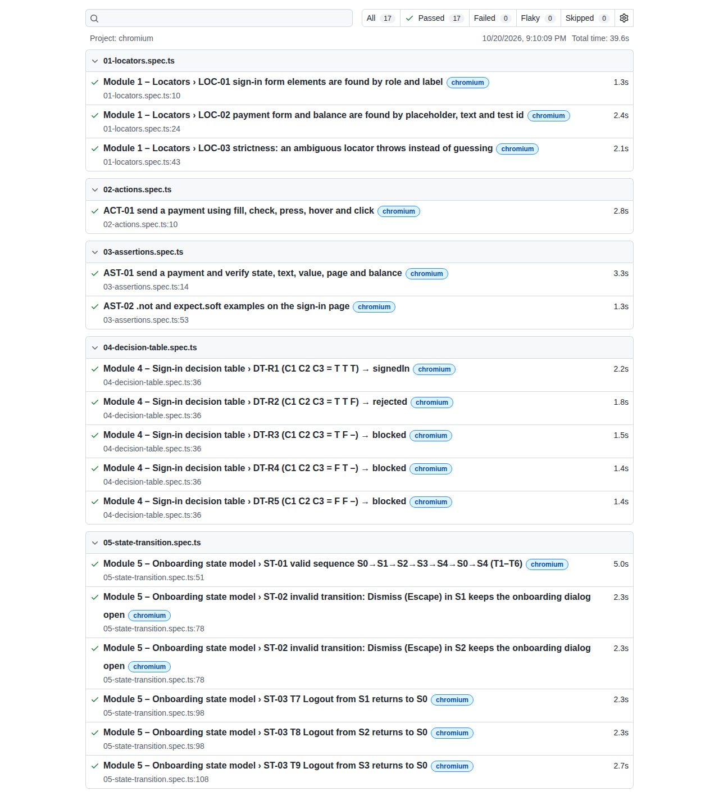
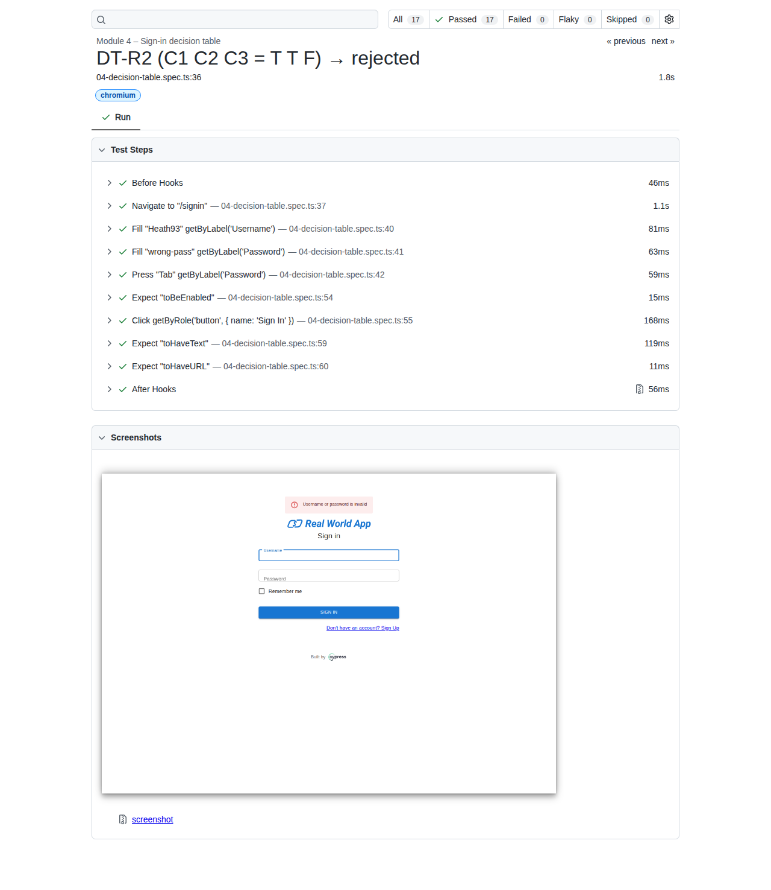
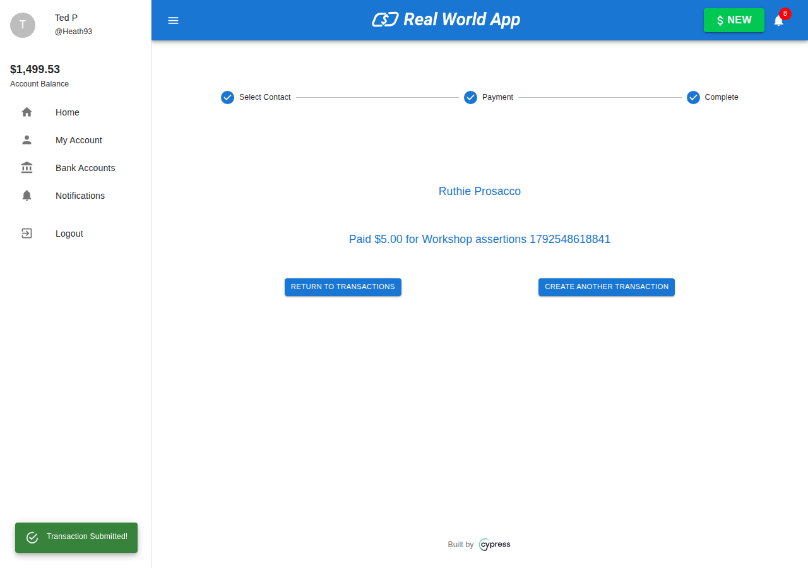
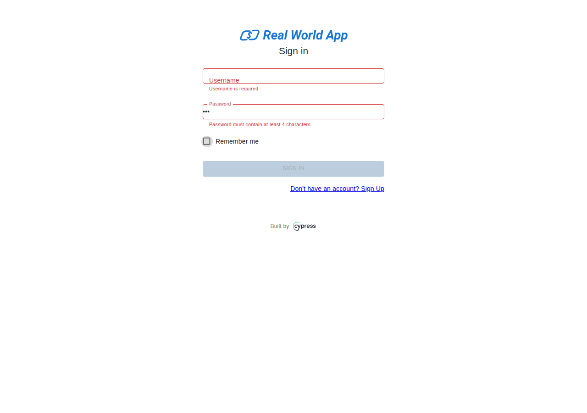
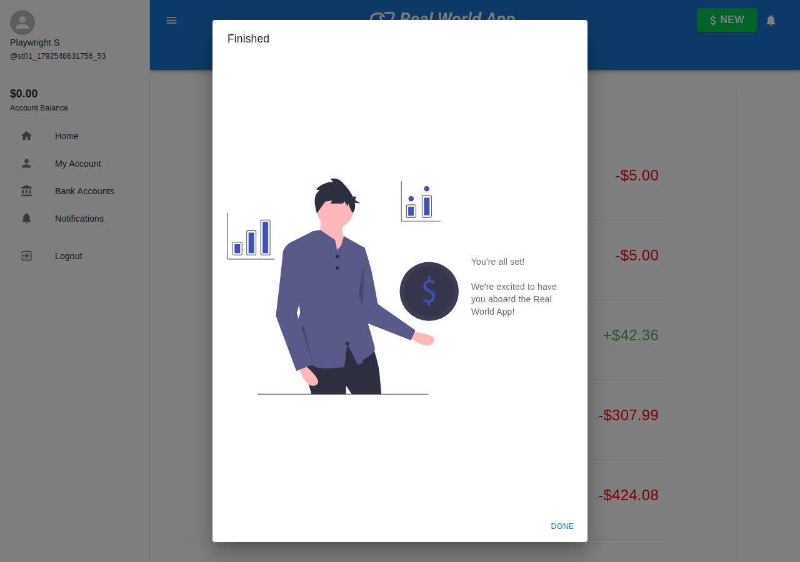
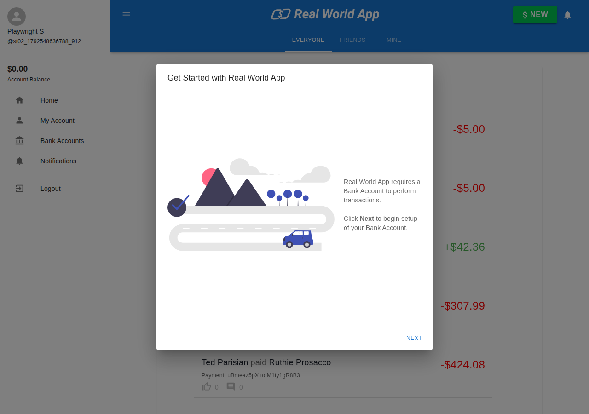

# RWA Playwright workshop – third term

Universidad ECCI – Software Testing and Quality (Pruebas y Calidad de Software) · Teacher: Oscar Sarabino

Team: Juan Jose Chavez Caicedo · Joseph Daniel Giraldo Medina

Playwright Test suite for the [Cypress Real World App](https://github.com/cypress-io/cypress-realworld-app) (RWA), organised by the five workshop modules.

| Spec | Module |
| --- | --- |
| `tests/01-locators.spec.ts` | 1 Locators |
| `tests/02-actions.spec.ts` | 2 Actions |
| `tests/03-assertions.spec.ts` | 3 Assertions |
| `tests/04-decision-table.spec.ts` | 4 Decision tables (sign-in rule, 5 rules) |
| `tests/05-state-transition.spec.ts` | 5 State transitions (new-user onboarding) |

## Run

1. Start RWA from its own root folder: `yarn dev` (front end on http://localhost:3000, API on http://localhost:3001).
2. In this repository: `npm install`, then `npx playwright install chromium` (first time only).
3. `npx playwright test`. Use `npx playwright show-report` for the HTML report and `npx playwright test --ui` for UI Mode.

Set `RWA_URL` and `RWA_API_URL` if the app runs on other ports. The tests share the RWA database, so they run with 1 worker.

## Evidence

Full run on 2026-10-20 (Bogotá time): 17 passed. Terminal output: [`evidence/run-2026-10-20.log`](evidence/run-2026-10-20.log).

| HTML report – 17 of 17 passed | Decision table DT-R2 – steps and screenshot |
| --- | --- |
|  |  |

| AST-01 payment confirmation | DT-R5 both validation messages |
| --- | --- |
|  |  |

| ST-01 state S3 "Finished" | ST-02 still S1 after Escape |
| --- | --- |
|  |  |
